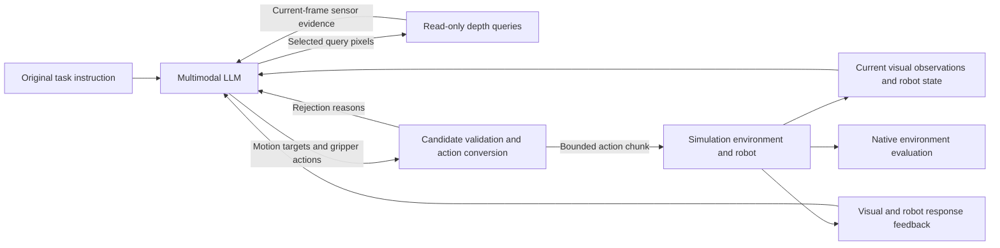

# Agent2Act

Agent2Act is a closed-loop control framework connecting multimodal large language models (LLMs)
to robots. The model uses the original task instruction, visual observations, and robot state
to choose the next operation. Agent2Act provides read-only sensor queries, action conversion,
and local validation to turn decisions into robot commands. New observations and measured
robot responses inform the next decision. The service connects to simulation environments
through the CoRobot WebSocket + msgpack protocol.

| Execution mode | LLM output | Execution backend |
|---|---|---|
| `motion` | End-effector targets and waypoints | Local time parameterization, interpolation, and action validation |
| `policy` | Local task instructions | Action models such as π0.5 / OpenPI |

Fixed modes and `auto` routing are supported. Rejected actions trigger bounded replanning;
the runtime never silently switches execution modes.

## System overview



In the LLM-only path, the model chooses manipulation targets. The execution layer handles
coordinate conversion, backend-specific IK and trajectory compilation, and action validation.
The model can query depth evidence from the current observation; queries neither move the robot
nor acquire new frames. After execution, the LLM uses new visual observations and measured robot
responses to continue, correct an action, or declare completion. Proposed actions, issued commands,
and observed results are recorded separately. Generating executable commands does not establish
successful manipulation.

The default G2 configuration uses pure `motion`, five-candidate filtering, a gripper-center
interface, and raw depth pixel queries. Inputs include the original task instruction and general
robot-control information, without additional task-specific operation guidance or scoring progress.
Native environment evaluation determines task outcomes. Speed validation is configured separately
from IK and joint-range checks. The current G2 example disables speed validation and therefore
does not establish compliance with velocity or dynamics constraints.

See [Architecture and extensions](docs/architecture.md) for code layers and extension contracts,
and the [Configuration reference](docs/configuration-reference.md) for parameters.

## Quick start

This module lives at `source/agent2act` in the Genie Sim repository and uses its own uv
environment. It is installed separately from `geniesim bootstrap` and `geniesim deploy`.
Run the commands below from the module directory: the example URDF paths are relative to it.

Python 3.10–3.12 is supported; `.python-version` selects 3.10, matching the Docker image.
Dependencies are declared in `pyproject.toml` and locked in `uv.lock`; uv creates the environment.

```bash
# From the Genie Sim repository root
cd source/agent2act
uv sync --locked

# Offline demo: scripted decisions and synthetic observations, with no model calls
uv run --locked agent2act replay --config examples/demo.toml --request examples/observation.json
uv run --locked agent2act serve  --config examples/demo.toml
```

The demo generates 20 steps and sends the first 8. Its script contains one decision;
subsequent requests report that the script is exhausted.

To connect a live model:

```bash
AGENT2ACT_LIVE_LLM_KEY=... uv run --locked agent2act check --config examples/g2_llm_recipe.json
AGENT2ACT_LIVE_LLM_KEY=... uv run --locked python scripts/serve_llm.py --config examples/g2_llm_recipe.json
```

`check` validates configuration and component construction. It does not verify remote model
availability or simulation task success.

### Configuration

`examples/` contains one deployment configuration, `examples/g2_llm_recipe.json` for the G2
omnipicker, and one offline demo. See the [Configuration guide](examples/README.md) for how to adapt
it. Field descriptions are in the [Configuration reference](docs/configuration-reference.md).

`planner.type` selects the planning implementation; `execution.mode` independently selects
motion/policy/auto execution. Built-in planners are `responses`, `embodied` (Responses with
read-only geometry tools), `anthropic`, `gemini`, `chat_completions`, `scripted`, and `motion_probe`.
Switch providers by replacing the `planner` block; minimal examples are in the
[Configuration guide](examples/README.md).

Planners read API keys from the environment variable named by `planner.api_key_env`.
Set it to `null` for a local service that does not require authentication.
This project does not manage model weights, training, or GPU deployment.

Agent2Act's original source code is licensed under the
[Mozilla Public License 2.0](LICENSE), following Genie Sim's `source/geniesim` license.
Third-party materials retain their applicable terms. Robot-description sources,
included license texts, and unresolved redistribution items are documented in
[Third-party notices](THIRD_PARTY_NOTICES.md). A successful build does not resolve pending licenses.

TOML is also supported. Generate the public configuration JSON Schema with:

```bash
uv run --locked agent2act schema
```

Plugin factories validate their own options. `schema` describes only the shared structure
and does not replace checkpoint-specific calibration.

### Deployment

```bash
uv sync --locked --no-dev               # Core service only
uv sync --locked --no-dev --extra pi05   # With π0.5 support
```

Build the Docker image with this module as the build context:

```bash
# From source/agent2act
docker build -t agent2act .
```

The OpenPI client is managed by uv and pinned to an official repository commit. It is not part
of the core production dependencies. Initial synchronization requires PyPI and GitHub access;
prepare the uv cache in advance for offline environments.

Use `--host 0.0.0.0` for connections across containers or hosts.
The default bind address is `127.0.0.1:8999`.

## Running a real simulation

Agent2Act serves as a `corobot` policy backend for GenieSim. The simulator starts a task and sends
inference requests to Agent2Act's WebSocket endpoint. The GenieSim repository provides simulation
containers, scene assets, and the task framework; this repository provides the server.

**1. Terminal A: start the service.**

```bash
AGENT2ACT_LIVE_LLM_KEY=... uv run --locked python scripts/serve_llm.py \
  --config examples/g2_llm_recipe.json --mode motion
```

The service listens on `127.0.0.1:8999` by default. Use `--host 0.0.0.0` across containers or hosts
and ensure that the simulator can reach the address.

**2. Terminal B: start a task in the GenieSim environment.** Select the `corobot` policy and
point it to the service:

```bash
GENIESIM_INFER_RECV_TIMEOUT_SEC=1900 \
  geniesim benchmark run g2op_manip_clean_the_desktop --infer-host=127.0.0.1:8999
```

**3. Inspect the results.** Determine task success from the simulator's `evaluate_ret*.json`
output, not the process exit code. Service logs show model reasons, issued step counts, and
tracking feedback for each turn. Traces preserve full inputs and observation images.

### Receive timeout

The simulator's receive timeout must cover both network retry and replanning budgets:

```text
(max_replans + 1) × [(max_retries + 1) × timeout_s + max_retries × retry_max_delay_s]
```

The primary configuration uses `timeout_s=300`, `max_retries=20`, and `max_replans=2`, which can
amount to hours under this estimate. In deployment, reduce retries or adjust
`GENIESIM_INFER_RECV_TIMEOUT_SEC` to the estimated budget; the example value above does not cover
that full budget. No new observations arrive during the wait, and a longer timeout does not
provide real-time control guarantees.

### Current limitations

All three execution modes and the CoRobot protocol remain available. Observations are read only
at chunk boundaries. Local trajectories do not guarantee collision avoidance, reachability,
or dynamic feasibility. `issued` means sent, not successfully executed. The LLM's completion
judgment does not fabricate the benchmark's `done` signal. Task success rates require joint
evaluation with live LLMs, π0.5 checkpoints, and Isaac Sim.

Example model names, camera keys, action ordering, and `dt_s=1/30` require deployment-specific
calibration; they are not validated hardware configurations.

## Diagnostics

The manual service emits terminal logs, full JSONL logs, and per-request `.trace` archives by
default. Traces contain the actual model input, raw responses, observation images, and issued actions.

```bash
# Local observer: model inputs, public reasoning summaries, episode replay, and RGB target overlays
uv run --locked python scripts/serve_llm.py --config examples/g2_llm_recipe.json --ui

# Inspect saved records after a run
uv run --locked agent2act observe --trace-dir logs/agent-<timestamp>-<PID>.trace

# Generate an HTML report
uv run --locked python scripts/render_agent_report.py logs/agent-<timestamp>-<PID>.jsonl

# Export decision reasons paired with issued actions
uv run --locked python scripts/export_action_reasoning.py logs/agent-<timestamp>-<PID>.jsonl
```

`--ui` opens a browser; `--no-browser` only prints the URL. The observer does not change model
requests or action behavior. RGB projection requires calibration from the same frame;
when unavailable, the observer shows the image and explains why projection is unavailable.

The primary configuration enables `planner.diagnostic_mode`. Each turn, the model additionally
reports modality usage, evidence sources, object pixel/3D positions, and expected arm waypoint
projections. The terminal shows a compact table, and the HTML report marks model-reported pixel
positions on the referenced RGB images. These fields support inspection and do not generate
actions. Model reports, code-confirmed inputs, and environment feedback remain separate;
hidden chain-of-thought is not exposed.

With tracing enabled, the service also appends to `<trace-directory-without-.trace>.action-events.jsonl`
and flushes every event. The next observation's `previous_sequence` refers to the preceding
action, not the effect of the current action. Video time differs from wall-clock time because
GenieSim may pause recording during inference. Issued step counts are not playback frame counts.

## π0.5 policies

To let the LLM choose motion or local π0.5 and authorize a bounded sequence of policy chunks
under fresh observations, set `execution.mode` to `auto` and add a `policy` block:

```json
{
  "execution": {"mode": "auto", "allowed_modes": ["motion", "policy"]},
  "policy": {
    "default": "pi05",
    "backends": {
      "pi05": {
        "type": "pi05",
        "host": "127.0.0.1",
        "port": 8000,
        "checkpoint": "/path/to/checkpoint",
        "capabilities": [
          {
            "name": "local_instruction",
            "description": "Validated training scope",
            "instruction_scope": "local_subtask",
            "max_policy_chunks": 4
          }
        ]
      }
    }
  }
}
```

The LLM requests a budget through `policy_chunks` (including the first chunk; default 1), bounded
by `execution.max_policy_chunks`. Each fresh observation calls the policy directly until the
budget ends, then returns control to the LLM for review. `capabilities` define authorization
boundaries: `instruction_scope=local_subtask` accepts a local operation instruction;
`original_task` requires an exact match with `Observation.instruction`. Missing or unknown
`policy_capability`, excess budgets, or scope violations are rejected before inference.

Proposal review (`execution.proposal_review`) first generates a policy candidate. The LLM uses
robot FK and observations to accept it or make a bounded motion correction. See the
[Proposal review contract](docs/architecture.md#proposal-review-contract).

Calibrate the checkpoint, input/output mappings, camera keys, and `dt_s` for deployment.
This repository does not manage model weights, training, or GPU services.
See the [Policy backend contract](docs/architecture.md#policy-backend-contract) for details.

## Development and validation

```bash
make check       # Linting, formatting, type checks, unit tests, and integration tests
make build       # Build wheel and sdist
```

`make check` runs `ruff check`, `ruff format --check`, `mypy`, and `pytest`. CI uses the lockfile
on Python 3.10 / 3.12. Integration tests start local services only; they do not call model APIs
or require Isaac Sim. Update dependencies with `uv lock` and include `uv.lock` in the commit.

Unit tests cover configuration, action validation, geometry, and adapter protocols. Integration
tests cover process boundaries, session lifecycles, and CoRobot encoding/decoding. Tests use
synthetic observations and injected `post` implementations; protocol tests use local loopback
connections without external network services.

Check compatibility against the simulator's actual parser without importing Isaac Sim:

```bash
uv run --locked agent2act compat --source /path/to/corobotpolicy.py
```

See [Architecture and extensions](docs/architecture.md) for layering, extension points, and contracts.
