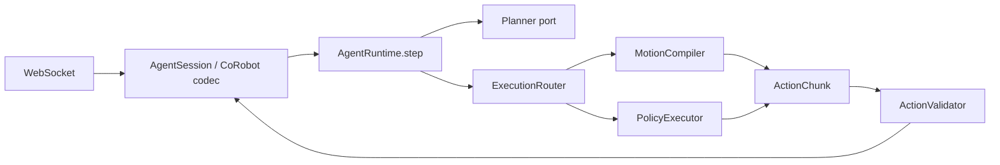

# Architecture and extensions

This document describes implementation layers and extension contracts. The flowchart shows
runtime calls; the dependency rules below constrain source imports.

## Dependency direction

`domain` depends only on the standard library and defines `Observation`, `Decision`, `ActionChunk`,
`RobotSpec`, and component ports. `application` and `execution` depend only on the domain layer;
they do not import adapters, configuration loading, the CLI, or networking libraries.
`adapters` implement domain ports, `service` provides the WebSocket session boundary, and
`bootstrap` is the sole composition entry point for concrete implementations.



Wire-protocol fields do not enter the application state machine. `Observation` contains normalized
state groups, images, and history, without retaining the raw CoRobot envelope.
To support a new simulator, add a codec and service session rather than protocol branches in
`AgentRuntime`.

The core API, `AgentRuntime.step(Observation) -> ActionChunk`, is independent of CoRobot and
network services. All components implement `reset()` / `close()`. Construction failures release
resources already created. Ownership follows runtime → router → executor, with `ExitStack`
used for cleanup.

## Mapping the control loop to the implementation

| Framework stage | Implementation | Responsibility |
|---|---|---|
| Observation ingestion | `service/session.py`, `adapters/simulators/` | Decode CoRobot requests, transform coordinates, and pass `Observation` to the core |
| Model input and decisions | `adapters/planners/` | Assemble images, state, control conventions, and history; parse provider responses into `Decision` |
| Read-only queries | `adapters/planners/embodied.py`, `raw_depth.py` | Execute model-selected queries on the current observation and return results within the same model exchange |
| Session control loop | `application/runtime.py` | Associate the last issued action with the current observation; manage event memory, bounded replanning, and episode resets |
| Routing and compilation | `application/routing.py`, `execution/`, `adapters/motion/` | Enforce fixed/auto routing and invoke motion or policy implementations through ports |
| Candidate filtering | `adapters/planners/ranked_motion.py` | Check candidates against the same observation and reuse the first validated chunk |
| Validation and issuance | `domain/validation.py`, runtime, session | Validate generated actions, select the issued prefix, and encode the response |
| Recording and review | runtime, `adapters/telemetry.py`, observer service | Keep proposals, rejections, issued actions, and subsequent observations separate; diagnostics do not determine task scores |

### A pure motion request

1. The session decodes an `Observation`. The runtime validates robot identity and state, and resets
   when the episode or original instruction changes.
2. The runtime compares current measurements with the previous issued prefix to build tracking
   feedback and recent events.
3. The planner adapter assembles the model input. Tool-enabled adapters query the same observation
   within a bounded number of rounds before returning a decision.
4. The router checks mode, capability, and reference frame; the motion backend compiles the target.
   Ranked candidates are validated in order. If all fail, rejection reasons return to the model
   within the replanning budget.
5. The runtime validates the full action chunk, selects the execution prefix, and records `issued`.
   The session encodes the `ActionChunk` for the environment.
6. After consuming the actions, the environment sends a new observation. Observed effects update
   only on the next `step`; model completion does not replace environment termination.

### Coordinates, candidates, and resource ownership

The gripper-center interface belongs to the planner adapter. Model-facing TCP targets are converted
to wrist targets using the target orientation. Raw `Observation` and core actions retain their
respective conventions. Camera projection requires calibration from the same frame; relabeling
a coordinate frame is not a transformation. `urdf_joint` reads URDF data, solves target IK, and
interpolates in joint space within the adapter layer. Bootstrap injects required execution
components through domain ports, so adapters do not import execution.

Ranked candidates require an executor declaring `compiler.endpoint_ik=true`. Bootstrap composes
the planner and executor without backend-name branches in the runtime. Cached candidates are
bound to the observation and decision, consumed once, and cleared. New observations require
recompilation. `reset` / `close` clear caches and owned components; construction failures roll
back created resources. Passing candidate checks establishes only compliance with configured
local checks, not collision avoidance, contact, or task success.

## Ports

| Component | Operations |
|---|---|
| Planner | `decide(observation, context) -> Decision` |
| ActionExecutor | `describe()`, `generate(observation, decision) -> ActionChunk` |
| PolicyBackend | `describe()`, `generate(observation, instruction) -> ActionChunk` |
| Motion compiler | `describe()`, `generate(observation, decision) -> ActionChunk` |

`describe()` must accurately declare supported capabilities. Unsupported additional constraints
must be rejected, never silently ignored. Built-in plugins use flat JSON options. Public
configuration rejects unknown fields; plugin factories validate their own options.

## Registering components

```python
from agent2act.bootstrap import ApplicationFactory, default_registry
from agent2act.configuration import load_config

registry = default_registry()
registry.planners.register("my_llm", lambda options: MyPlanner(**options))
registry.policies.register("my_vla", lambda spec, options: MyPolicy(spec, options))

factory = ApplicationFactory(load_config("deployment.json"), registry)
with factory.create_session() as session:
    response = session.handle(corobot_request)
```

Configuration selects implementations with `planner.type` and `policy.backends.<name>.type`.
The `backend` field in an LLM decision selects a registered execution backend. Duplicate
registration names raise an error.

Plugins use explicit Python registration. Entry points are not automatically discovered, and
arbitrary module paths from configuration are not executed.

Built-in planners: `responses`, `embodied`, `anthropic`, `gemini`, `chat_completions`, `scripted`,
and `motion_probe`. `embodied` extends Responses with read-only geometry tools. `anthropic` and
`gemini` reuse shared observation preprocessing, tool execution, tracing, and lifecycle logic,
changing the protocol only at the adapter boundary. The application and CLI do not branch on providers.

Built-in motion backends: `local_interpolation` (default; Cartesian interpolation), `urdf_joint`
(local IK followed by joint interpolation), and `fixed_steps` (single-target fixed-step retiming).
Factories receive `RobotSpec`, `MotionTiming`, and plugin options.

Built-in codecs: `corobot` (no conversion) and `corobot_ik_frame` (`base_link` → `arm_base_link`).

## Execution contract

Dual-arm actions use `JOINT_ABS` or `EEF_ABS`, with the same kind and frame on both sides.
Joint ordering follows the left/right lists in `RobotSpec`. EEF poses use
`[x,y,z,qx,qy,qz,qw]`, meters, unit quaternions, and `base_link` or `arm_base_link` coordinates.

All action sequences have equal lengths. The full chunk is validated before sending an
`execute_steps` prefix. Policies may set a separate prefix limit with `policy_execute_steps`.
Remaining dense actions are discarded by default rather than replayed across new observations.
Fixed modes cannot silently switch; `auto` selects only allowed and registered execution modes.

When the planner reports `complete` or `abandon`, the default response is a one-step hold.
`execution.complete_hold_steps=N` sends a full N-step hold, exempt from `execute_steps` and
`max_chunk_steps` because it only repeats the current command. This lets the simulator complete
its checks without further inference. These holds are labeled `planner_complete_unverified`
and `planner_abandoned`, respectively; neither establishes task success.

`motion_frame` restricts motion to one reference frame. The router enforces it for every planner
without relabeling frames or guessing transformations. `motion_frame_axes` contains three nonempty
strings describing axis directions, not a calibration matrix.

The CoRobot client consumes an entire chunk before requesting inference again; the chunk cannot
be interrupted midway. Metadata `dt_s` does not change simulation timestep and must match the
actual action consumption period. `issued` means sent, not successfully executed. Final success
is determined by the benchmark or an independent observation-based verifier.

## Policy backend contract

After the LLM grants a finite chunk budget, each fresh observation calls the policy directly.
Control returns to the LLM for review when the budget is exhausted:

```json
{
  "mode": "policy",
  "backend": "pi05",
  "instruction": "Pick up the red block nearest the left hand.",
  "reason": "Use the configured manipulation policy for the contact operation; review the lift next.",
  "success_condition": "The head view shows the selected block lifted off the table with the hand.",
  "status": "continue",
  "motion": null,
  "policy_chunks": 4
}
```

`policy_chunks` is the total budget including the first execution, defaulting to 1.
`execution.max_policy_chunks` (default 1, maximum 32) bounds requests. Excess budgets are rejected,
not silently clipped. Only `mode=policy, status=continue` may request multiple chunks.

Each request validates the observation and boundaries, reuses the local instruction if a grant
remains, calls the policy again, validates the full new chunk, sends its prefix, and accumulates
issued steps and nominal duration. Budget exhaustion returns control to the LLM. During a grant,
only action-contract checks are performed. Policies have no standard success signal; the LLM
reviews outcomes afterward, while the environment still determines episode termination.

Rejected policy actions, transport timeouts, or other non-contract exceptions revoke the grant.
The LLM receives the reason and cumulative issued amount for correction within `max_replans`.
The runtime does not automatically switch to motion to imply success. `policy_continued` marks
grant reuse; `policy_review_required` includes `budget_exhausted` or an error reason.

`robot.dt_s` must match both policy output timing and simulator consumption timing.
`gripper_clip_tolerance` allows gripper values that exceed a boundary by no more than the tolerance
to be clipped. Larger violations reject the entire chunk. Joint actions are not clipped.

`capabilities` define authorization boundaries. With `instruction_scope=local_subtask`, the LLM
supplies a stable local operation instruction. With `original_task`, the policy instruction must
exactly match `Observation.instruction`. When a backend declares at least one capability, missing
or unknown `policy_capability`, excess budgets, and scope violations are rejected before inference.
Legacy backends without capability declarations remain compatible.

## Proposal review contract

`execution.proposal_backend` / `proposal_capability` authorize a candidate source for the full
original instruction; only capabilities declaring `original_task` are accepted. At each review,
the application calls the policy, maps actions, applies speed handling, validates the full chunk,
and computes an FK summary. The planner returns `proposal_id` to accept that same candidate,
or returns a motion correction.

`Decision.assessment` includes `execution_status` (not_started/progressing/failed/uncertain/recovered),
`intent_status` (aligned/misaligned/uncertain), evidence fields, subgoals, and two optional requests:
`observation_request` requires uncertain intent and may use `command_bounds` to bound a gripper
probe; `motion_alternative` requires aligned intent and a strictly shorter command duration.
The two requests are mutually exclusive, must bind to the current proposal, and must obey fixed routing.

A proposal is bound to the observation, session sequence, backend, capability, and instruction,
and can be consumed only once. `proposal_max_age_s` limits the wait after generation; expired
proposals are rejected. Bounded observation actions must fit entirely within the motion prefix
and use `policy_chunks=1`. These bounds apply to explicit observation motions, not ordinary
policy acceptance.

## Gripper presets and hardware

Gripper presets belong to configuration and adapters. `configuration` selects and validates
versioned definitions and expands them into planner parameters. `adapters/embodiments` supplies
packaged data and hardware-description generation. Core domain/application/execution layers do
not know preset names. With tracing enabled, the service records a hardware snapshot; raw preset
content and provenance do not enter model input.

See the [Configuration reference](configuration-reference.md) for fields.

## Observer service

`--ui` / `observe` use bootstrap's `create_observer` to construct a local observer subprocess.
It reads only traces and action-event indexes and serves pages over loopback HTTP. Core layers
do not depend on the UI. Diagnostic snapshots are not appended to model input, and closing the
browser does not affect actions. Offline `observe` creates neither a planner nor a simulator connection.

## Logging and errors

The application emits structured events; logging adapters add session IDs. Default JSON logs go
to stderr, and CLI results go to stdout. JSONL does not embed images or API keys. Optional traces
separately preserve full observations, model inputs, and raw model responses.

`ConfigurationError` indicates startup or composition problems. `ContractError` indicates invalid
observations, decisions, or actions. The service retains the legacy string `error` and adds
`error_code` and `session_id` when available. Unknown upstream exceptions expose only their type.

Budget exhaustion distinguishes `planning_exhausted` (decision/action correction budget) from
`transient_backend_exhausted` (retryable upstream HTTP/network budget). Only explicitly classified
failures end the current episode. They do not fabricate `episode_done`, bypass action limits,
or automatically switch fixed modes.
