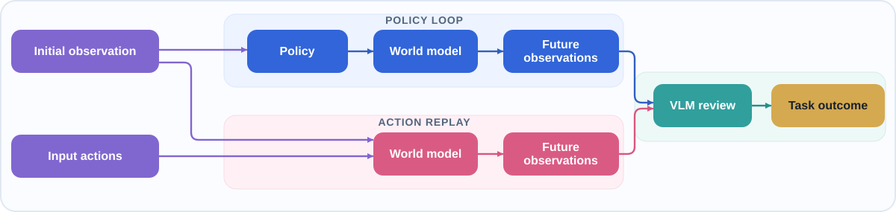

# Genie Sim Dream 🌙

Release version: the local `VERSION` links to the repository root `VERSION`
(**3.5.0**). Wheel metadata and runtime `__version__` use that release value.

Genie Sim Dream generates G1 and G2 robot videos in a browser. Start with one
of [20 examples](examples/) and choose how actions are supplied:

- **Action replay:** use actions saved in an example.
- **Policy loop:** use pi0.5 to predict actions from generated observations.



## Quick start

Use a Linux machine with an NVIDIA GPU and a compatible driver. Dream has its
own Python environments, separate from `geniesim bootstrap`. The complete
ModelScope world model and five policies total about 72 GB. A first run needs
only the world model and G1 bread policy from that set, plus the evaluator;
allow extra space for generated videos.

From the repository root, enter the package directory once. The linked guides
and commands below use this directory:

```bash
cd source/geniesim_dream
```

1. **Install** the three Python environments using the [installation guide](docs/setup.md).
2. **Get the models.** Put `fd_cosmos/` and `policy/g1-bread-v1/` from
   [ModelScope](https://www.modelscope.cn/datasets/agibot_world/GenieSim3.0-Dataset/tree/master/wm_checkpoints)
   in `checkpoints/`, and download the
   [Qwen3.5 evaluator](docs/assets.md#evaluator-models). The launcher needs
   all three asset directories even for recorded action replay. Add other task
   policies or Qwen3-VL when you need them.
   See the [asset guide](docs/assets.md) for the expected layout.
3. **Start** the services:

   ```bash
   ./tools/start_services.sh
   ```

   Keep this terminal open; it prints the UI address when all four services
   are ready. Ctrl+C stops them.
4. **Run a session** at **http://127.0.0.1:8971/**. Choose
   **Closed loop · pi0.5 policy** and a G1 bread example. Keep the default
   **20 chunks**, select **Create session** and **Run continuously**, then
   **Generate full video** and optionally **Run VLM evaluation**. Find the video
   under `outputs/<session-id>/`; the evaluation report appears there if you
   ran the VLM step.

## Tested environment

Tested on Ubuntu 24.04.2 LTS with GCC 13.3.0 and an NVIDIA H100 or H200 GPU.

## Guides

| Guide | What you will find |
| --- | --- |
| [Installation](docs/setup.md) | Submodules, three Python environments and install checks |
| [Models and assets](docs/assets.md) | Required downloads and directory layout |
| [Running Dream](docs/running.md) | Launcher, browser workflow and troubleshooting |

For technical details, see the [maintenance guide](AGENTS.md). The
[run-dream recipe](skills/run-dream/SKILL.md)
is for operators and coding agents.

## License and credits

Genie Sim Dream's original platform and evaluation code, the 20 included
examples and the G2 kinematics URDF are licensed under [MPL 2.0](LICENSE).
The extracted policy adapter retains its Apache-2.0 terms.

Dream uses [NVIDIA Cosmos Framework](https://github.com/NVIDIA/cosmos-framework.git)
and [Physical Intelligence OpenPI](https://github.com/Physical-Intelligence/openpi.git).
See [third-party provenance](THIRD_PARTY.md) for pinned revisions and notices,
and the [optional integrity check](docs/assets.md#optional-integrity-check) for
downloaded files.
