# geniesim_ros — the realtime Genie Sim engine

**Interactive realtime physics simulation for robotics, exposed natively as ROS 2.**

`geniesim_ros` is the engine that turns Genie Sim from a script-driven simulator
into a first-class ROS 2 node: USD scenes, USD robots, GPU physics, and
photoreal rendering — all driven by the same `/joint_command`, `/tf`,
`/joint_states`, `/clock`, `/odom`, and camera topics every ROS stack already
speaks. The runtime is built around **closed-loop interactivity**: teleop,
MoveIt plans, ros2_control controllers, and live RViz feedback all share the
same `sim_time` and the same world state, so a human in the loop sees and
reacts to the simulation as if it were hardware.

License: [Mozilla Public License Version 2.0](LICENSE)
Routing / contributor map: [AGENTS.md](AGENTS.md)
Shared runtime references and acceptance: [docs/README.md](docs/README.md)

Shared Python code is maintained for Python **3.10 and 3.12**. `geniesim docker`
defaults to dedicated `docker6.2`. Isaac Sim **4.5**, standalone **5.1**, and
the **5.1 + 6.2 combo** are **deprecated (E.O.L.)**; their code is retained.
See [runtime acceptance](docs/ISAACSIM_ACCEPTANCE.md) for measured 6.2 coverage.

---

## Key features

| | |
|---|---|
| ⚡ **Interactive realtime physics** | Closed-loop sim that responds to live teleop, planner, and controller commands without buffering or replay tricks. Physics, render, and ROS publishers share a single `sim_time` so the operator and the robot agree on what's happening *now*. |
| 🧮 **Multiple physics backends, one workspace** | Pick at launch with `launcher_config:=…`: Isaac Sim PhysX (stable rigid), Isaac Sim Newton (rigid, experimental), or **Newton-standalone** (Kit-free, supports cloth + soft bodies in addition to rigid). |
| 👕 **Cloth & soft body in the loop** | Newton-standalone is designed for deformables — cloth folding, fabric drape, FEM tet bars — alongside the rigid robot. Multiple solvers are wired in so a scene yaml can opt into the one that fits the material; the engine bridges them all to the same render and RViz feedback. |
| 🦿 **Customizable robots, AS3-native assets** | `genie_sim_robot_model` ships multiple robots out of the box (Genie G2 family, Franka, UR5, Aloha, ARX, …) and lets you bring your own via xacro / URDF — the offline mesh tools normalize OBJ names, inject missing inertials, and stage the result into Isaac Sim's **AS3 asset layout** (per-robot directory with `robot.usda` + `payloads/Physics/{physics,physx,mujoco}.usda`). The engine consumes that layout uniformly; switching physics backends never rewrites the asset. |
| 🤖 **Isaac Sim runtimes** | `docker` defaults to `docker6.2`, using the SDK bundled in base 6.2.0.1 through a system-Python adapter, without a duplicate SDK install. Standalone 5.1, the 5.1 + 6.2 combo and 4.5 runtimes are deprecated (E.O.L.); compatibility code remains. AS2/AS3 import and layout differences are handled at the runtime boundary; acceptance is recorded per image and interpreter. |
| 🦾 **MoveIt 2 for Genie G2** | Drop-in `move_group` + WBC RViz for the Genie G2 family (G2 is the Tier 1 robot). Ships three IK plugins (KDL-coupled, bio_ik-coupled, relaxed-IK) with G2 coupled-joint constraints, plus an RRT-Connect + TOPP-RA planner. Other robots run on the engine but don't have a packaged MoveIt config — port the SRDF and `coupled_constraints.yaml` if you need one. |
| 🎨 **OVRtx rendering, two modes** | **Inline OVRtx** runs inside the Newton-standalone process — zero-copy `body_q → omni:xform` via Warp, photoreal viewport with no IPC. **Standalone OVRtx render node** runs as a separate ROS process consuming `/tf_scene` and robot `/tf`, ideal when physics and rendering need different CPU/GPU budgets. Both paths print a first-run shader-compile heartbeat so operators know warmup vs hang. |
| 📦 **Ships as a single pip wheel** | A built `geniesim_ros` wheel contains the pre-built colcon `--merge-install` tree (modes preserved via a tarball trick); consumers don't need colcon. Editable installs still let you `geniesim ros build dev` for iteration. |
| 🌐 **ROS 2 Jazzy** | Jazzy is the active system runtime for the dedicated 6.2 container. Shared Python 3.10/Humble code checks do not qualify the E.O.L. Isaac 4.5 runtime. |
| 🛰️ **Live RViz integrations** | Custom marker / PointCloud2 publishers for deformable surfaces, free-joint rigid objects, and an RViz2-driven free-camera pose plugin. The renderer's `/tf_render` channel pushes per-body local transforms so the USD stage stays in lockstep with physics. |

---

## Quick start

Demos use **Genie G2 (Tier 1)**.

For the Wuji wok scene, use the
[Wuji chef Newton startup recipe](skills/run-wuji-chef-newton/SKILL.md)
to launch the Newton XPBD engine.

### 1. Bring up the container

```bash
geniesim docker up            # boots the Isaac Sim 6.2 + Jazzy container
geniesim docker into          # opens an interactive shell inside it
```

Run `geniesim -h` to see the container variants and the current support
matrix. The remaining steps run **inside** the container shell.

### 2. Build the ROS 2 workspace

```bash
cd /workspace                                            # repo root, mounted by `docker up`
geniesim ros build dev                                   # symlink-install, RelWithDebInfo
source devel/setup.bash                                  # overlay the built workspace
```

`geniesim ros build dev` writes to `./devel`, `./devel_build`, `./devel_log`
(intentionally namespaced so they can't collide with a release build under
`./install`).

### 3. Launch a scene

Two demo scenes × two launchers — four combinations cover the surface
most users hit. The launcher decides the **physics engine + renderer**;
the scene yaml decides the **robot variant + task**.

**Scene reference**

| Scene | Robot | What it showcases |
|---|---|---|
| `scene_pnp_g2_op` | Genie G2 + **omnipicker** | Pick-and-place workflow |
| `scene_wbc_g2_sp` | Genie G2 + **swiftpicker** | Whole-body control workflow |

**Launcher reference**

| Launcher | Physics engine | Renderer | Status |
|---|---|---|---|
| `launcher_ovrtx_isaac_physx` | Isaac Sim PhysX | Standalone OVRtx node | ✅ Stable — start here |
| `launcher_newton_mjwarp`     | Newton-standalone (mujoco-warp) | Inline OVRtx/Newton GL/RViz | Tier-1 rigid path |

**Combinations** — any scene with any launcher:

```bash
# Pick-and-place + stable Isaac PhysX
ros2 launch genie_sim_bringup app.launch.py \
  scene:=scene_pnp_g2_op \
  launcher_config:=launcher_ovrtx_isaac_physx \
  headless:=false
```

```bash
# Pick-and-place + standalone Newton MuJoCo-Warp
ros2 launch genie_sim_bringup app.launch.py \
  scene:=scene_pnp_g2_op \
  launcher_config:=launcher_newton_mjwarp \
  headless:=false
```

```bash
# Whole-body control + stable Isaac PhysX
ros2 launch genie_sim_bringup app.launch.py \
  scene:=scene_wbc_g2_sp \
  launcher_config:=launcher_ovrtx_isaac_physx \
  headless:=false
```

```bash
# Whole-body control + standalone Newton MuJoCo-Warp
ros2 launch genie_sim_bringup app.launch.py \
  scene:=scene_wbc_g2_sp \
  launcher_config:=launcher_newton_mjwarp \
  headless:=false
```

The two axes are independent: swapping the scene changes which gripper
the robot is built with and which RViz layout / demo task you see;
swapping the launcher changes the physics backend and which OVRtx mode
runs. `launcher_ovrtx_isaac_physx` starts a separate renderer.
`launcher_newton_mjwarp` defaults to Newton GL; select
`physics_engine_visualizer:=ovrtx` for inline OVRtx. See the
[Engine support matrix](#engine-support-matrix) below for the full grid.

### 4. (optional) MoveIt 2 + WBC RViz

MoveIt config is `arm` + `gripper` aware — pass either or both to swap
the URDF and the SRDF xacro mappings.

```bash
# Default (g2 + crsB + swiftpicker):
ros2 launch genie_sim_moveit wbc.launch.py

# crs + omnipicker:
ros2 launch genie_sim_moveit wbc.launch.py arm:=crs gripper:=omnipicker

# Mix (crs + swiftpicker, etc.):
ros2 launch genie_sim_moveit wbc.launch.py arm:=crs
```

The launch wires both args into the URDF filename and into the SRDF
xacro mappings, so any `(arm, gripper)` combo with a corresponding URDF
on disk will work. Match this to whichever `scene_*_g2_{op,sp}` you
launched in step 3 so the planner and the simulator agree on the
robot.

---

## Engine support matrix

Each row is a `launcher_config:=…` value. Mix-and-match physics + renderer
is controlled by the launcher yaml; you don't pass `physics_engine` or
`physics_solver` on the CLI.

> The Isaac Newton wrapper and deformable solver combinations are experimental.
> Standalone MuJoCo-Warp is a Tier-1 rigid test path. A configured route is not
> per-scene acceptance; use the [bringup results](src/ros_ws/src/genie_sim_bringup/README.md#results-matrix).

| Launcher | Physics engine | Solver | Rigid bodies | Cloth / soft body | Renderer | Status |
|---|---|---|---|---|---|---|
| `launcher_ovrtx_isaac_physx` | Isaac Sim PhysX | PhysX 5 | ✅ | ⚠️ via PhysX (PhysxParticleCloth etc.) — not actively maintained | Standalone OVRtx node | ✅ **Stable — default** |
| `launcher_ovrtx_isaac_newton` | Isaac Sim Newton (wrapper) | mujoco-warp | 🧪 **UNSTABLE** | ❌ (wrapper bridges rigid-body schemas only) | Standalone OVRtx node | 🚨 **EXPERIMENTAL** |
| `launcher_newton_mjwarp` | Newton-standalone | mujoco-warp | ✅ | ❌ | Newton GL by default; optional inline OVRtx | Tier-1 rigid path |
| `launcher_newton_fsvbd` | Newton-standalone | Featherstone + VBD-family | 🧪 **UNSTABLE** |🚨 **EXPERIMENTAL** | Inline OVRtx | 🚨 **EXPERIMENTAL** |
| `launcher_newton_avbd`  | Newton-standalone | augmented-VBD-family | ✅ |🚨 **EXPERIMENTAL** | Inline OVRtx | 🚨 **EXPERIMENTAL** |
| `launcher_newton_mjvbd` | Newton-standalone | mujoco-warp + VBD-family | ✅ |🚨 **EXPERIMENTAL** | Inline OVRtx | 🚨 **EXPERIMENTAL** |
| `launcher_newton_mjxpbd` | Newton-standalone | mujoco-warp + XPBD-family | ✅ |🚨 **EXPERIMENTAL** | Inline OVRtx | 🚨 **EXPERIMENTAL** |

> Newton provides the cloth/soft-body combinations listed here. Libuipc owns
> native IPC scenes. Deformable routes are experimental; use backend-specific
> acceptance checks before drawing task-level conclusions.

### Isaac Sim × ROS distro × Docker variant

Matches `geniesim -h`. The `geniesim docker` variants are how this surface
is exposed; bare `geniesim docker` aliases to the default (`docker6.2`).

| Isaac Sim | ROS 2 | Container image | CLI entry | Status |
|---|---|---|---|---|
| 6.2 (base **6.2.0.1**, bundled SDK / system-Python adapter) | Jazzy | `geniesim4` | `geniesim docker` / `geniesim docker6.2` | **Default**; component checks recorded, full release acceptance incomplete |
| **5.1 bundled / 6.2 system** | **Jazzy** | `geniesim3` | `geniesim docker5.1` | Deprecated (E.O.L.); code retained |
| 4.5 | Humble | `geniesim2` | `geniesim docker4.5` | Deprecated (E.O.L.); code retained |

### Robot tiers (from `genie_sim_robot_model`)

| Tier | Robots | What it means |
|---|---|---|
| **Tier 1** | Genie G2 family (crs/omnipicker, crsB/Swiftpicker and crsB/Wuji) | Primary maintained test family. Use the scene results matrix for completed checks. MoveIt config + WBC launch are G2-only. |
| **Tier 2 — reference only** | `agilex/aloha`, `agilex/piper`, `arx/x5`, `arx/acone`, `franka/fr3`, `universal_robots/ur5` | URDF/xacro kept correct; URDF→USD import expected to work. Scene yamls and physics tuning may be stale — treat as starting points. |

Bring-your-own robots are supported via xacro / URDF — see
`genie_sim_robot_model` for the offline mesh-prep tools that stage assets
into the AS3 layout the engine consumes.

---

## What's in the box

Thirteen ROS packages, each with its own `AGENTS.md` for routing details:

- **Bringup & engine**: `genie_sim_bringup`, `genie_sim_engine_core`,
  `genie_sim_engine_isaacsim`, `genie_sim_engine_newton`, `genie_sim_render`
- **Application client**: `genie_sim_client` — Newton process ownership, immutable state and step/reset requests
- **Shared build glue**: `genie_sim_common`
- **Robot + visualization**: `genie_sim_robot_model`, `genie_sim_rviz_plugins`
- **Motion stack (Genie G2)**: `genie_sim_moveit`, `genie_sim_moveit_plugins`
- **ros2_control**: `genie_sim_control`, `genie_sim_controllers`
- **Python helpers**: `genie_sim_planning`

---

## 🔗 ROS-package dependency DAG

How the workspace packages depend on each other. Read from `package.xml` of every package under `src/ros_ws/src/`.

```mermaid
graph TD
  %% Auto-generated by `geniesim tool ros-dag --fix`.
  %% Edges: -->|build|/|buildtool| build-time deps;
  %%        ==>|exec| runtime deps; -.->|test| test deps.
  %% Source: source/geniesim_ros/src/ros_ws/src/*/package.xml.

  genie_sim_bringup["<b>genie_sim_bringup</b>"]
  genie_sim_client["<b>genie_sim_client</b>"]
  genie_sim_common["<b>genie_sim_common</b>"]
  genie_sim_control["<b>genie_sim_control</b>"]
  genie_sim_controllers["<b>genie_sim_controllers</b>"]
  genie_sim_engine_core["<b>genie_sim_engine_core</b>"]
  genie_sim_engine_isaacsim["<b>genie_sim_engine_isaacsim</b>"]
  genie_sim_engine_libuipc["<b>genie_sim_engine_libuipc</b>"]
  genie_sim_engine_newton["<b>genie_sim_engine_newton</b>"]
  genie_sim_moveit["<b>genie_sim_moveit</b>"]
  genie_sim_moveit_plugins["<b>genie_sim_moveit_plugins</b>"]
  genie_sim_planning["<b>genie_sim_planning</b>"]
  genie_sim_render["<b>genie_sim_render</b>"]
  genie_sim_robot_model["<b>genie_sim_robot_model</b>"]
  genie_sim_rviz_plugins["<b>genie_sim_rviz_plugins</b>"]

  genie_sim_bringup ==>|exec| genie_sim_engine_newton
  genie_sim_bringup ==>|exec| genie_sim_engine_isaacsim
  genie_sim_bringup ==>|exec| genie_sim_render
  genie_sim_bringup ==>|exec| genie_sim_robot_model
  genie_sim_moveit ==>|exec| genie_sim_robot_model
  genie_sim_moveit ==>|exec| genie_sim_moveit_plugins
  genie_sim_moveit ==>|exec| genie_sim_control
  genie_sim_moveit ==>|exec| genie_sim_controllers
  genie_sim_moveit ==>|exec| genie_sim_planning
  genie_sim_render ==>|exec| genie_sim_engine_isaacsim
  genie_sim_bringup ==>|exec| genie_sim_common
  genie_sim_client ==>|exec| genie_sim_common
  genie_sim_control ==>|exec| genie_sim_common
  genie_sim_controllers ==>|exec| genie_sim_common
  genie_sim_engine_core ==>|exec| genie_sim_common
  genie_sim_engine_isaacsim ==>|exec| genie_sim_common
  genie_sim_engine_isaacsim ==>|exec| genie_sim_engine_core
  genie_sim_engine_isaacsim ==>|exec| genie_sim_engine_newton
  genie_sim_engine_libuipc ==>|exec| genie_sim_common
  genie_sim_engine_libuipc ==>|exec| genie_sim_engine_core
  genie_sim_engine_newton ==>|exec| genie_sim_common
  genie_sim_engine_newton ==>|exec| genie_sim_engine_core
  genie_sim_moveit ==>|exec| genie_sim_common
  genie_sim_moveit_plugins ==>|exec| genie_sim_common
  genie_sim_planning ==>|exec| genie_sim_common
  genie_sim_render ==>|exec| genie_sim_common
  genie_sim_robot_model ==>|exec| genie_sim_common
  genie_sim_rviz_plugins ==>|exec| genie_sim_common
```

**Legend:** `-->|buildtool|` build-system toolchain (e.g. `ament_cmake`) · `-->|build|` C++/CMake build deps · `==>|exec|` runtime deps (`<exec_depend>` / `<depend>`) · `-.->|test|` test-only deps. Methodology + how to regenerate: see [`AGENTS.md` § ROS-package DAG — methodology](AGENTS.md#-ros-package-dag--methodology).

<!-- AUTOGEN:ros-dag start -->

<!-- AUTOGEN:ros-dag end -->

See [AGENTS.md](AGENTS.md) for the package table, build instructions, the
wheel-packaging contract, and the dispatch rules that make the same source
run across the supported Isaac Sim versions.


## Optional native IPC backend

The independent [libuipc backend](src/ros_ws/src/genie_sim_engine_libuipc/README.md)
adds native IPC physics while the existing Isaac and Newton backends remain
available. Select `launcher_libuipc`, `launcher_libuipc_ovrtx`,
`launcher_libuipc_isaacsim` or the three-task `launcher_libuipc_wuji_eval` through
the normal launch entry point. Its scene configuration uses the `libuipc:` block.

[IPCClient](src/ros_ws/src/genie_sim_client/IPC_CLIENT.md) adds correlated action
completion and physical-state/image observations independently of the existing
Newton client protocol. [Synchronized capture](src/ros_ws/src/genie_sim_render/docs/SYNC_CAPTURE.md)
is opt-in; ordinary live rendering keeps its existing behavior. Native solving
and GPU image capture require separate acceptance in the prepared runtime.
