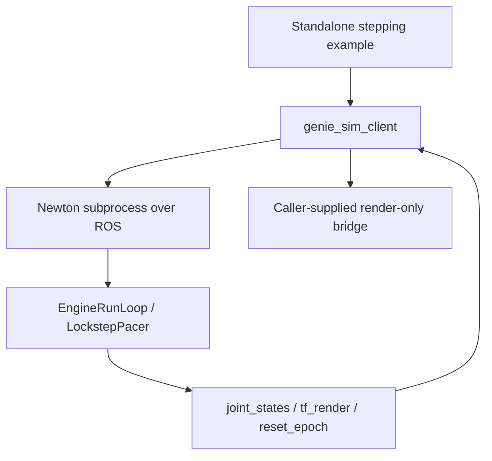

# Shared Newton client design

The shared client and standalone stepping example are implemented. This document
describes their API and engine protocol boundaries. Application adapters, scoring
and CLI dispatch are outside the client API.

## 1. Dependency and ownership boundaries



Import `ClientConfig` and `SimulationClient` from `genie_sim_client` directly.
The outer `geniesim_ros` distribution owns wheel extraction, not this client API.
The package imports no application or physics runtime. ROS imports are delayed
until start. Dependencies are NumPy, PyYAML, rclpy, standard ROS messages and
ros2run, with `genie_sim_common` providing CMake glue. The caller installs the
engine separately. `/rlinf/*` topic names are engine protocol names.

| Owner | Responsibilities |
| --- | --- |
| Client | Process lifecycle, ROS transport, state waits, reset credentials, named layouts, immutable snapshots |
| Engine | Physics integration, reset application, configuration and publication semantics |
| Application | Actions, observations, episodes, policies, rewards/checkers, scoring and reports |
| Renderer/caller | Cameras, applying snapshots, render barrier and resource lifetime |

## 2. Transport and process lifecycle

`RosEngineBridge` retains world-major position commands, reset triples and an
atomic joint/body cache exposed through `read_state()`. `SimulationClient`:

1. Starts an isolated `ros2 run` process group and captures its logs.
2. Subscribes before launch and waits for three distinct readiness messages,
   stable real names and body state.
3. Serializes `(N,J)` targets in published name order.
4. Waits for new joint and sufficiently fresh body state.
5. Confirms resets by epoch and body freshness.
6. Closes the process group with SIGINT, TERM, then KILL if necessary.

Startup failures release owned resources. A launcher exit does not prove its
child exited; failed group cleanup retains the process reference and prevents
replacement. Executor failure propagates. The client does not modify CUDA or
pacing environment variables.

## 3. Configuration: launcher and scene only

```python
config = ClientConfig.from_files(launcher_yaml, stage_manifest, headless=True)
client = SimulationClient(config, ready_timeout_s=600, step_timeout_s=5)
```

The manifest is an assembly artifact pointing to scene YAML, not a third physics
configuration channel. The client requires that reference to exist. The engine
still validates the full manifest schema, assets and backend configuration.
The client does not download assets or silently run task/scene assembly.

The selected launcher's `ros__parameters` supply solver, profile, physics_hz,
num_envs, scene_yaml_defaults and pacing. Values are serialized to ROS `-p`
arguments. The manifest and launcher paths are derived artifact identities.

Required launcher values:

- `step_mode: lockstep`;
- positive integer `step_lockstep_ticks`;
- positive finite `physics_hz`;
- `use_tf_render: true`.

`num_envs` follows the documented engine default of 1 when absent. The client
understands uniform batched wire layouts, but the current Newton
backend ABI still limits multi-world operation. Layout tests do not establish
N>1 physics support; application acceptance starts with one world.

There is no constructor `control_hz`, implicit rounding, or environment-variable
physics override. For example, 100 Hz and K=4 request 0.04 s per command.
`config.step_duration` describes that **request**, not measured committed time.
The example launcher uses stock `physics_params.yaml`; RLinf may separately
select its training profile in its own launcher.

The standalone example is installed with the client Python package:

```bash
python3 -m genie_sim_client.examples.newton_joint_step \
  --launcher /absolute/launcher.yaml \
  --manifest /absolute/stage/manifest.json --steps 10
```

It uses `SimulationClient` directly: start, reset, copy measured joint positions,
send ten explicit target requests, close, then print final state as JSON. Optional
`--joint NAME --target VALUE` changes that joint's target in each world. It imports
neither application and includes no task runner, checker, scoring or report writer.
Episode loops, task scoring and report writing remain application-owned.

## 4. Shared step contract: arrival_v1

```python
result = client.step(joint_targets, render=False)
snapshot = result.snapshot
```

start/step/reset/snapshot/close reject concurrent calls on the same client.
Targets must be finite `(num_envs, num_joints)` full position arrays. The client
uses actual published joint names; it does not invent `joint_0` fallbacks.
World-qualified layouts must have uniform `env_i/...` sets. Duplicate names,
missing worlds, mixed qualified/unqualified names and topology changes fail.
Unqualified names remain valid for a single world.

The client records joint sequence before publishing, waits for it to advance,
then waits for a new body sequence whose stamp is at least the latest joint
stamp. It copies the resulting cache under one bridge lock. It does not send
another action, compute reward, or auto-reset.

**This is not a command-correlated commit protocol.** The engine still:

- free-runs before its first command;
- receives activity and the actual command latch through separate subscriptions;
- uses a short latch settle delay rather than a common command ID;
- publishes joint/body channels and GPU-to-host mirrors without a unified commit credential.

A startup message in flight may satisfy sequence advancement. A fresh body stamp
does not prove that the selected GPU state was committed for this command.
Another publisher/reset source makes attribution even less reliable.

The capability is explicitly `arrival_v1`. Requesting
`completion="committed_v2"` raises before sending. Tests of Python stepping must
not be described as proof of exact K-tick physics completion.

A session requires exclusive engine/control ownership of its ROS domain/topic
set. This version does not provide same-domain multi-session namespace isolation.
`spawn=False` attaches to a configuration-compatible external engine still in
startup grace; it cannot verify that engine's solver or own its recovery.

## 5. Snapshot and reset contracts

| Field | Contract |
|---|---|
| schema | Per-world joint_names, body_paths and num_envs; no guessed object categories |
| joint_positions / joint_velocities | Owned, immutable float32 `(N,J)` arrays |
| body_poses | Owned, immutable float32 `(N,B,7)`, world xyz + quaternion WXYZ |
| observation_id | Client-local read sequence, not an action ID or engine tick |
| joint_sequence / body_sequence | Independent ROS cache arrival sequences |
| joint_stamp / body_stamp | Publisher wall-clock seconds, **not sim_time** |
| reset_epoch | Engine credential carried in the same JointState as reset state |

The client does not fabricate simulation time, contact data, camera images,
object classifications or unsupported geometry queries. The bridge subscribes
only to joint/body state; the public snapshot promises joints and body poses.
A checker cannot interpret missing geometry as a passing condition.

reset(None) selects all worlds. Empty, duplicate or out-of-range IDs fail;
seed/instance vectors must match selected IDs and fit the wire's integer range.
`-1` keeps the engine's existing no-change semantics. NumPy integer indices are
accepted. After publishing, the client waits for reset_epoch advancement and a
body batch at least as new as its confirming reset stamp. Engines without an
epoch are unsupported; there is no sequence-only stale-state fallback.

A global epoch identifies this reset only under the exclusive reset-source
assumption. It does not add command correlation to ordinary stepping.

## 6. Failure, lifetime and rendering

After-send transport timeout, invalid state or topology failure poisons a session
until close/start. Physics may already have advanced: the client never retries or
replays automatically. Recovery of an external engine belongs to its owner.

Client-owned process groups and bridge resources are released at close. The
shared global rclpy context remains owned by the host, so closing a client does
not tear down other nodes.

`RenderBridge.render(snapshot)` is optional. `client.step(render=True)` obtains
physics state first, then calls the supplied renderer and returns its output in
`StepResult.rendered`. Without a renderer, the request fails before action send.
A renderer error cannot undo or replay physics. The client does not provide
a Kit renderer or camera/engine frame-matching implementation.

For rendering without a command, call the supplied renderer with
`client.snapshot()`. It may apply poses and wait for images; it must not
integrate a second simulation world.

## 7. Application use and verification

The [application integration guide](BENCHMARK_HANDOFF.md) demonstrates the current
client API, action batching, reset/render boundaries and failure handling.
Application adapters and task scoring are not supplied by this package.

The client tests cover configuration, names/layouts, immutable state, reset
freshness, timeout/no-replay and process cleanup without importing ROS/GPU or
applications. The optional rclpy loopback checks real ROS APIs in one process.
Neither test establishes cross-process DDS, native physics, renderer frame
correlation or multi-world execution. Use the [README commands](README.md#verification)
for these checks. Protocol extensions are tracked in the [roadmap](../../../../docs/ROADMAP.md).

## Additive lifecycle barrier

The client can pause/resume an attached engine using Empty services plus GetState readback. Pause is also permitted after action failure, but never clears the poisoned-session flag. Lifecycle confirmation is not an action commit or camera-freshness credential. The benchmark owns its separate frozen-state image and task-progress joins.
