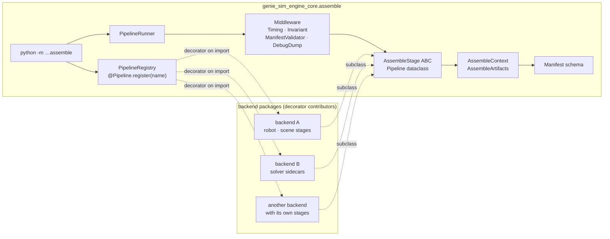

# genie_sim_engine_core

Cross-backend physics-engine contract for the GenieSim platform.

Provides the abstractions for concrete physics-engine packages:
the `PhysicsEngine` ABC, the run loop, the shared run-loop scaffolding
(`EngineSession`, `EngineRunLoop`, `EngineNodeParams`), the shared
mimic-joint helper, the **assemble pipeline** (orchestrator +
`AssembleStage` ABC + `Manifest` schema) that composes each scene's
stage-dir artifacts before the engine starts, and the **pacing layer**
(step modes, lifecycle coordination) that decouples loop timing from
physics implementation.

The workspace launchers select `genie_sim_engine_isaacsim` or
`genie_sim_engine_newton`; both consume these shared contracts and the ROS bridge.

## Step modes and lifecycle

The loop supports three pacing modes (configured via `step_mode` launcher param):

- **`realtime`** (default) — wall-clock pacing scaled by `realtime_factor`
- **`lockstep`** — one command = exactly `step_lockstep_ticks` physics ticks
  (for RL training where trainer step rate drives sim rate)
- **`freerun`** — no pacing, step as fast as hardware allows (benchmarking)

Episode lifecycle (`/reset_envs` service, pause/resume) is handled by
`RosResetCoordinator` (backend-agnostic) + backend-specific episode_reset
implementation. See [pacing.py](genie_sim_engine_core/common/pacing.py) and
[lifecycle_ros.py](genie_sim_engine_core/common/lifecycle_ros.py) for the contracts.

## What lives here

- `genie_sim_engine_core.engine.base.PhysicsEngine` — the ABC every
  concrete engine implements.
- `genie_sim_engine_core.engine._mimic` — shared mimic-joint helper
  (`parse_mimic`, `expand_targets`).
- `genie_sim_engine_core.common.early_params` — startup parameter
  inspection that has to run before the ROS executor spins.
- `genie_sim_engine_core.common.loop.EngineRunLoop` — physics + render
  step scaffold shared by every entry point.
- `genie_sim_engine_core.common.session.EngineSession` — owns setup
  from physics-params loading through `set_topology`.
- `genie_sim_engine_core.common.params.EngineNodeParams` — typed
  dataclass coercing the raw ROS `{str: str}` params dict.
- `genie_sim_engine_core.schema.scene` — the typed scene-yaml reader,
  and the single declaration of the base-pin vocabulary
  (`PinBaseMode`: `weld` | `mocap` | `free`, plus the rule that turns
  `pin_base_to_world` + `pin_base_mode` into one of them). Both the
  schema validator and every routing consumer read it from here, which
  is why the mode is a `str`-subclass enum rather than a bare string.
- `genie_sim_engine_core.common.scene_config` — thin BC shims over the
  above (`parse_pin_base_to_world`, `parse_pin_base_mode`,
  `parse_convert_joints_to_fixed`); new code reads the schema directly.
- `genie_sim_engine_core.common.pacing` — step-mode pacers
  (`RealtimePacer`, `LockstepPacer`, `FreerunPacer`).
- `genie_sim_engine_core.common.lifecycle_ros` — `RosResetCoordinator`
  for episode lifecycle (`/reset_envs` service, reset-epoch tracking).
- `genie_sim_engine_core.assemble` — pre-engine pipeline that composes
  the per-scene stage dir. See [Assemble pipeline](#assemble-pipeline).

## Adding a backend

Concrete backend packages build-depend on `genie_sim_engine_core`,
subclass `PhysicsEngine`, and register themselves through the engine
factory. The factory dispatches by the `physics_engine` ROS parameter.

```python
from genie_sim_engine_core.engine.base import PhysicsEngine


@PhysicsEngine.register("my_backend")
class MyBackend(PhysicsEngine):
    def __init__(
        self,
        *,
        robot_prefix: str,
        scene_usda: str,
        robot_usda: str,
        render_layer_usda: str,
        physics_hz: float,
        render_hz: float,
        simulation_app,
        logger,
        params,
        robot_from_urdf: bool,
        init_joint_pos,
        runtime_usd_dump_path: str,
        **_unused,
    ) -> None:
        ...
```

## Assemble pipeline

Before an engine starts, a per-scene **stage dir** is composed from
the scene YAML: robot USD, render layer, `manifest.json`, and any
backend-specific sidecars (e.g. `newton_solvers.json`, or a
backend-composed runtime asset). Core owns the orchestrator so every
backend plugs into one CLI, one manifest schema, and one set of
cross-cutting middleware.

### Layering



### Core-owned primitives

- `genie_sim_engine_core.assemble.context.AssembleContext` — frozen
  inputs (scene path, output dir, base path, physics_engine, scene
  cfg, resolved robot source) + a mutable `AssembleArtifacts` for
  stage outputs. Stages receive it; they don't parse argv.
- `genie_sim_engine_core.assemble.stage.AssembleStage` — the ABC.
  Class attrs `name`, `produces`, `requires`, `optional`. Method
  `run(ctx) -> StageResult`. Method `skip_reason(ctx)` for conditional
  skips (returned reason is logged by the runner).
- `genie_sim_engine_core.assemble.pipeline.Pipeline` — a named,
  ordered stage list. `Pipeline.validate()` runs the
  `produces`/`requires` DAG check before any stage executes.
- `genie_sim_engine_core.assemble.pipeline.PipelineRunner` — executes
  stages in order, wraps each in registered middleware, aggregates
  results into the final `Manifest`.
- `genie_sim_engine_core.assemble.manifest.Manifest` — the versioned
  cross-backend schema. Core owns the top-level fields; each backend
  contributes a slice under `physics.<engine_key>.*`. The complete field
  definitions live in [schema/manifest.py](genie_sim_engine_core/schema/manifest.py).
- `genie_sim_engine_core.assemble.middleware` — cross-cutting hooks.
  Ships with `TimingMiddleware`, `InvariantMiddleware` (checks every
  `produces` file exists after `run()`), `ManifestValidatorMiddleware`
  (checks backend ownership of manifest slices), and
  `DebugDumpMiddleware` (per-stage stage-dir snapshots).
- `genie_sim_engine_core.assemble.pipeline.Pipeline.register` — the
  decorator that registers a pipeline factory under a name. Matches
  the `PhysicsEngine.register` pattern: consumers explicitly import
  each backend's assemble module, which triggers the decorator.
- `genie_sim_engine_core.assemble.__main__` — the CLI:
  `python -m genie_sim_engine_core.assemble --scene X --output-dir Y
  --base-path Z --physics-engine E`.

### Adding a pipeline

Backend packages contribute stage subclasses and register a pipeline
factory via `@Pipeline.register(name)`. Core imports nothing from
backends; consumers import the backend's assemble module (or the CLI
does via a known-module list) to trigger registration.

```python
# in <your_backend>/assemble/__init__.py
from genie_sim_engine_core.assemble import Pipeline
from .my_first_stage import MyFirstStage
from .my_second_stage import MySecondStage


@Pipeline.register("my_backend")
def my_backend_pipeline() -> Pipeline:
    return Pipeline(
        name="my_backend",
        stages=[MyFirstStage, MySecondStage],
    )
```

The CLI accepts `--pipeline-module <import.path>` (repeatable) so
launchers can list backend packages to import before dispatch —
mirroring how `PhysicsEngine` backends are imported today.

```python
# in <your_backend>/assemble/my_first_stage.py
from genie_sim_engine_core.assemble import AssembleStage, StageResult


class MyFirstStage(AssembleStage):
    name = "my_first_stage"
    produces = frozenset({"artifact_a.json"})
    requires = frozenset()  # first stage, no upstream

    def skip_reason(self, ctx):
        if ctx.inputs.robot_source.kind != "urdf":
            return "robot_source is not urdf"
        return None

    def run(self, ctx):
        # Backend-heavy imports happen HERE, at call time — never at
        # module-import time. The @Pipeline.register decorator runs
        # without triggering these imports.
        from my_backend._impl import do_the_work
        outputs = do_the_work(ctx.inputs)
        return StageResult(
            files_added=outputs,
            manifest_slice={"physics": {"my_backend": {...}}},
        )
```

Cross-backend reuse: a pipeline factory can compose stages from
another backend by importing them directly. Pipelines are Python
values, not YAML — refactoring, IDE navigation, and type checking all
work.

### Scene YAML picks a pipeline by name

```yaml
physics_engine: my_backend        # → picks the "my_backend" pipeline
```

The stage list is code (backend's `assemble/__init__.py`), not YAML.
Scene YAML only picks which pipeline to run.

### Manifest schema

`Manifest` is the shared contract between the assemble step and the
engine that reads the stage dir. Its main field groups are:

| key | ownership |
|---|---|
| `version` | core; bump with schema changes |
| `physics_engine`, `launcher_config` | core; assembly engine and launcher identity |
| `base_path`, `stage_dir`, `scene_yaml` | core; asset and assembly paths |
| `scene_usda`, `robot_usda`, `background_usda`, `robot_visual_usda`, `render_layer_usda` | core; optional USD asset paths |
| `robot_prefix`, `robot_from_urdf` | core; robot identity and source |
| `files` | core; logical name → path |
| `cameras`, `lidars`, `free_cam_prim_path` | core; sensor configuration |
| `robot`, `scene` | core; cross-backend topology and source metadata |
| `physics.<engine_key>` | backend; opaque to core, validated by the reading engine |

Backends adding new cross-backend fields go through a core PR (bumps
`version`, updates the JSON schema, updates every backend). Backends
adding engine-specific fields put them under `physics.<engine_key>`
and document them in their own README.

## Engine constructor ABI checks

`PhysicsEngine.register()` records a lightweight ABI summary from each
backend class's `__init__` signature. `PhysicsEngine.create()` validates
its keyword arguments against that summary before constructing the
backend. This catches core/backend drift at the factory boundary instead
of deep inside a launch.

The check reports:

- missing required constructor parameters;
- unexpected parameters for strict constructors;
- the backend class and accepted parameter names.

For example, if `EngineSession` starts passing a new `dds_hz` keyword but
a strict backend constructor does not accept it, creation fails with a
focused `TypeError` naming `dds_hz` as an unexpected parameter.

Backends that intentionally tolerate backend-specific or unrecognised core
parameters can include `**_unused` or `**kwargs` in their constructor.
Those backends still fail on missing required parameters, but unknown
extra keywords are allowed.

## Inspecting registered backend ABIs

Backend modules register themselves when imported. A lightweight local
smoke check can inspect the registered ABI records without starting a
simulation:

```bash
python3 - <<'PY'
from genie_sim_engine_core.engine.base import PhysicsEngine

# Import installed backend modules here to populate the registry.
# A core-only installation has an empty registry.

for name, abi in sorted(PhysicsEngine.registered_backend_abis().items()):
    print(f"{name}: {abi.class_name}")
    print(f"  required: {abi.required_names}")
    print(f"  accepts extra kwargs: {abi.accepts_extra_kwargs}")
PY
```

To validate a candidate creation call without instantiating the backend,
call the validation helper directly:

```python
PhysicsEngine._validate_create_kwargs("my_backend", engine_kwargs)
```

## Python compatibility

The core ABI layer uses only Python 3.10-compatible standard-library
features: `dataclasses`, `inspect.signature`, and `typing` collection
aliases already used in this package. Keep backend-facing interface code
compatible with both Python 3.10 and 3.12.

If override annotations are added in backend code, import them from
`typing_extensions` rather than `typing` so Python 3.10 remains supported:

```python
from typing_extensions import override
```

## Verification

From this package directory, run each suite separately so its fixtures remain
isolated:

```bash
for suite in api assemble lifecycle pacing params publish schema session; do
  python3 -m pytest -q "tests/$suite" || exit 1
done
```

The import test blocks physics SDKs and backend packages. Assembly tests cover
stage dependencies, artifact existence, manifest ownership and middleware skip
hooks. Tests that inspect robot assets or scene configurations skip when their
owning packages do not provide those fixtures.
