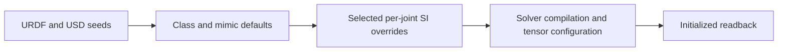

# Runtime parameter application

Class defaults, assembly seeds and selected sysid values serve different stages
of model construction. The launcher selects a physics profile; the scene selects
the robot and ordered `robot.joint_overlays` stack.

## Resolution and precedence

An explicit overlay value wins after class tuning, including zero. An omitted
field retains the fallback. Mimic followers remain undriven; nonzero selected
follower drive gains are rejected. Solver readback is required because a value
in a generated URDF or root USDA does not prove it reaches the live model.

| Path | Application boundary | Verification |
| --- | --- | --- |
| Isaac PhysX 6.2 | `kit/joint_params.py` writes native axis passive properties and USD seeds, then applies SI articulation gains after the class pass | USD properties and live tensors |
| Isaac Newton wrapper, experimental | USD seeds, tensor gains and final model overrides after passive class writes | Final Newton arrays and compiled solver |
| Standalone Newton MuJoCo-Warp | `common/joint_params.py::apply_newton_joint_params` after class/mimic fallbacks, before solver construction | Model arrays and compiled MuJoCo values |
| Featherstone/AVBD | Selected runtime stacks rejected | Explicit baseline configuration only |
| Libuipc | No runtime overlay consumer | Xacro inertial selection only |

Core owns the schema and sparse resolver. Backend helpers resolve package URIs,
select the schema engine key, convert units and validate solver names. No backend
runtime imports belong in core.

## Units and scope

Passive damping and drive damping stay separate on native PhysX 6.2 and Newton
MuJoCo-Warp. Angular USD drive gains and PhysX viscosity are per degree;
Newton model arrays and articulation tensors are SI. Coulomb friction is an
effort, not a load-dependent coefficient. Older PhysX cannot apply the selected
native passive stack and rejects it.

Link inertials use the selected sysid xacro. General overlay-to-URDF application,
command delay and torque constant are not implemented. Backend capability and
parameter delivery do not establish identical solver response or hardware fit.

See the canonical [joint parameter reference](../../../../../docs/JOINT_PARAMS.md),
[measurement caveats](../../genie_sim_robot_model/robots/SYSID_PARAMS.md) and
[asset consumption](asset_consumption.md).
