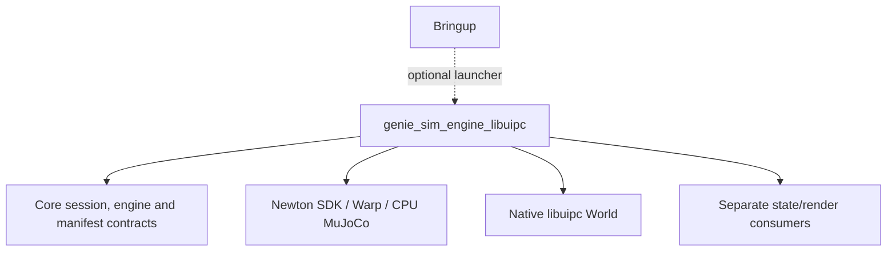

# Independent libuipc backend

## Dependency boundary



Libuipc implements the core `PhysicsEngine` ABI and imports neither the Newton
backend nor the Isaac backend package. Newton SDK model/state/FK is an intentional
dependency. Runtime requires no Isaac or Kit. Local assembly uses core and USD;
cold URDF conversion invokes an external Isaac importer process. Its pipeline
omits NewtonExtrasStage and Newton scene/solver sidecars.

## Ownership

Paths below are relative to `genie_sim_engine_libuipc/` inside this package.

| Path | Responsibility |
| --- | --- |
| `engine.py`, `session.py` | Registration, core integration, commands, readback and lifecycle |
| `driver.py`, `config.py` | SDK/native stepping and validated solver settings |
| `scene.py`, `geometry.py`, `body_bindings.py`, `usd.py` | Object construction, authored mappings and USD policies |
| `cpu/`, `feedback.py` | Latest/barrier CPU MuJoCo or measured-joint input |
| `action_sequence.py` | Immutable actions and source/epoch discovery |
| `observation_snapshot.py` | Completed-frame snapshots and ROS transport |
| `physical_state_recording.py` | Lossless archives and strict readers/followers |
| `deformable_publisher.py` | Completed-state topology/frame publication |
| `solver/` | SolverIPC extension and retained vendor license |
| `assemble/` | Package-local importer, scene stages and path helpers |

The assembly implementations and SDK helpers are independently owned here.
Importer fixes require an explicit review of the local implementation; a sibling
backend import is not an extension mechanism. Retain copyright and license
notices. See [solver attribution](genie_sim_engine_libuipc/solver/PROVENANCE.md).

## Build and configuration

For installation and ordinary ROS builds, see the
[setup guide](README.md#installation-and-build).

| Setting | Value / ownership |
| --- | --- |
| Engine / solver | `libuipc` / `ipc` |
| Launchers | `launcher_libuipc`, `launcher_libuipc_ovrtx`, `launcher_libuipc_isaacsim`; three-task `launcher_libuipc_wuji_eval` |
| Scene block | `libuipc:`; settings validated by `IPCConfig` |
| Substeps / worlds | One fixed substep and world 0 only |
| Robot inputs | CPU and measured-input profiles are mutually exclusive |
| Rendering | Separate render backends consume completed rigid/deformable state |

Mixed `newton`/`libuipc` runtime configuration is rejected. Offline
[particle capture and native probes](examples/README.md) use ordinary Docker/ROS
orchestration, launcher-derived settings and fresh output directories. Particle
capture is not a recorder, video encoder or deterministic coupling layer.

## Initialization

1. Open scene and reference the physics robot; edit only the session layer.
2. Compose AS3 Physics, apply base placement and pinned-root/fixed-joint policies, baking initial angles.
3. Capture IPC source geometry and body/mesh offsets, deactivate replaced source
   prims and normalize disabled physics schemas.
4. Register IPC attributes and Newton/Physx/Mjc resolvers, import the robot/remaining scene, add ground,
   compile optional CPU geometry and build the declared IPC objects.
5. Finalize SDK data, seed robot coordinates/mimic followers, run FK and seed both
   state buffers and model.body_q before constructing native state.
6. Validate kinematic ownership, bind inputs and construct the native solver.
7. Attach ROS inputs and deformation producers after core session initialization.

Scalar positions use q indices; velocities use qd indices. Synthetic fixed joint
values remain on joint_states. Task body readback includes mesh-to-authored-root
offsets. SDK xyz+xyzw becomes xyz+wxyz at the publish boundary. Odometry uses
base-frame linear-then-angular velocity.

## SDK and USD conventions

AS3 Physics is composed in a private session before body/joint inspection.
Manifest paths identify actual rigid owners rather than visual wrappers. Cold
conversion validates the exact movable-joint inventory before publishing success.
Geometry instances expand only under a rigid owner with no rigid descendants;
rigid/material/component instances retain their ownership. Root-weld repair
accepts only a topmost rigid child and world endpoint, and edits the session
layer; internal joints through non-rigid frames retain their endpoints.

`mjc:damping` uses SI units through `SchemaResolverMjc`; angular DriveAPI gains
retain USD's per-degree convention. The private command buffer follows
`model.joint_q`. Scalar coordinates use `q_start`; velocities, limits and damping
use `qd_start`, including FREE/BALL-before-scalar layouts. No global SDK target-
layout override is installed. Local assembly helpers adapt the in-tree importer
implementations and retain their copyright/provenance notices; there are no
sibling-backend runtime imports.

## Stepping, reset and shutdown

Each fixed tick consumes robot input, advances/retrieves native state once,
swaps completed output buffers and publishes deformation from that completed
tick. There is no second particle solver or graph capture. dt must equal the
constructed dt; physics_solver_substep must equal 1.

The CPU worker defaults to asynchronous wall-time execution (`latest`). Outer
lockstep alone does not synchronize CPU/IPC, and latest-mode CPU continues while
native IPC is paused. Opt-in `barrier` keeps CPU idle until a numbered request,
executes its exact batch and validates sequence, counts and start/end times
before native IPC advances. Thread/process workers share this protocol. Failure
or invalid/late ACK has no held-state fallback; a post-send failure makes that
transaction unusable. CPU-ACK/native failure requires native reset or a new owner.

`engine._sim_time` is authoritative and continues across non-recording resets.
Recorded sequence epochs each restart their tick/time at zero.
Every CPU batch receives the previous completed engine time. CPU total counts
belong to their worker owner and restart independently. The ratio must satisfy
`cpu_mujoco.physics_hz = physics_hz * sync_substeps`.

| `libuipc.cpu_mujoco` setting | Default | Contract |
| --- | --- | --- |
| `synchronization` | `latest` | `barrier` opts into numbered CPU batches. |
| `sync_substeps` | `1` | Positive integer CPU steps per IPC tick; rate ratio must match. |
| `sync_timeout_s` | `0.5` | Positive finite ACK budget; timeout breaks coupling. |
| `dynamic_proxies` | `[]` | Unique exact declared `rigid_mesh` names; requires barrier. |

Each dynamic proxy is seeded from the previous raw completed native body pose
and COM twist, with body-origin/COM and XYZW/WXYZ conversions applied once.
Only CPU robot rows return to IPC; proxy predictions are diagnostic. Native IPC
owns dynamic props/deformables. Full axis-scaled source geometry and YAML
mass/density determine proxy mass, COM and locked inertia; collision components
have zero density. Concave colliders require explicit `cpu_collision.method:
coacd` and positive `threshold` (default `0.01`); decomposition failure aborts,
without a one-hull fallback. Rigid proxies reject `cpu_collision.margin`.

Reset detaches owned inputs, invokes SolverIPC.reset/native World recovery,
restores joint targets and measurement freshness, then reattaches input. Recorded
sequences reset the CPU barrier worker in place using acknowledged native
`mj_resetData`, initial qpos/controls and `mj_forward`; contact/solver warm starts
and command freshness are discarded. The existing non-recording path may restart
its input owner.
reset_epoch advances only after success. Native construction state is the reset
reference; settled-state resnapshotting is not claimed.

Only world 0 is supported. Geometry instance switching, arbitrary native snapshots,
runtime model mutation and nonzero wheel-velocity commands are unsupported.
Scalar position commands and external measured input remain supported.

Shutdown closes the CPU worker/subscription and owned coordinator resources,
releases native/SDK references and preserves the shared rclpy context.
Repeated shutdown is safe.

## Actions, snapshots and archives

These features are opt-in scene/launcher settings under `libuipc`:

```yaml
libuipc:
  action_sequence:
    topic: /ipc/action
  observation_snapshot:
    topic: /ipc/observation
  state_recording:
    enabled: true
    output_dir: output/fresh-episode/physical_state
```

The action/snapshot blocks accept only `topic`, an absolute prefix other than
`/` without a trailing slash. Actions require CPU barrier mode. Recording accepts
boolean `enabled` (default false) and a fresh `output_dir` when enabled. Absent
blocks preserve existing latest/measured-input behavior; no environment variable
turns these features on. The [public client protocol](../genie_sim_client/IPC_CLIENT.md)
owns JSON discovery, command/retry, snapshot and identity schemas.

One engine source identity and reset epoch bind actions, snapshots and archives.
Ready identity follows initial FK/native construction and transport startup.
The physics owner freezes each action target and advances CPU, native solve,
readback, tick/time, post-step work, archive and snapshot work before counting
one committed solve. Completed action counts establish integration, not target
convergence. Between actions the world continues stepping with the last target;
inference and rendering never pause it.

Snapshots copy completed state independently of publication/downsampling. They
include all constructed deformable ranges and authored-root world `xyz+wxyz`
body poses, with body offsets applied once. Their depth-one retained state
supports late renderer discovery without replaying requests. Synchronized
rendering consumes the same frozen state for all camera products; its
[GPU completion contract](../genie_sim_render/docs/SYNC_CAPTURE.md) is separate
from physical time.

The `geniesim_physical_state_v1` archive contains a JSON manifest, JSONL index
and raw `particle_q`, `particle_qd`, `body_q`, `body_qd`, `joint_q`, `joint_qd`
streams. Raw `body_q` remains body-origin `xyz+xyzw`, with authored-root bindings
stored separately. Dtypes/shapes and independent q/qd layouts are preserved.
All six arrays are mandatory; an SDK-provided empty array needs explicit
`metadata.zero_count_arrays` metadata. Missing arrays are never fabricated.
The initial tick/time/dt-zero frame follows FK and native construction; every
subsequent physical tick is recorded independently of ROS publication.

Frames require finite arrays, contiguous ticks, increasing simulation time,
byte offsets/lengths and SHA-256. Shutdown closes all streams and verifies every
byte before clean closure. `PhysicalStateArchive` and
`PhysicalStateArchiveFollower` normally require clean closure and complete file
verification; follower `.verified` becomes true only after full exhaustion and
final verification. `require_clean=False` is forensic access and grants no
normal follower verification. The [scoring contract](../../../../../geniesim_benchmark/README.md#deformable-scoring)
requires the strict reader and final receipt.

CPU/native, readback, post-step, archive or publication failure latches execution
failure, cancels actions/snapshots and closes recording dirty before another
transaction. ROS callbacks record transport faults as plain data; the physics
owner performs terminalization without SDK work in the callback. An in-flight
native solve cannot be preempted. Shutdown attempts all resources even after an
earlier failure. An open physical archive owns one episode: reset is rejected before
changing inputs/native state until that archive is sealed. A startup YAML
`libuipc.episode_sequence` may preload successive `{state_recording, material}`
entries. Each has a unique fresh output/receipt path; the initial entry matches
`libuipc.state_recording` and `generalization.material`. No geometry or solver
mutation is allowed. The backend-local episode channel accepts only begin,
finish and the next configured reset index. It never changes the core ABI.

Finish pauses the physical owner and verifies/closes all committed archive bytes.
The legacy v1 `solver_shutdown_clean` field denotes this clean episode boundary
alongside `recording_clean`; it does not imply the simulation process exited.
During scoring and next-layout material capture the world remains paused. Reset
restores native construction state and cached kinematic/joint aims, resets CPU
integration, opens a fresh epoch archive at tick/time zero, and acknowledges only
after all state writes and archive creation succeed. Begin resumes physical time;
capture/inference within the running episode still do not pause physics. A failed
or uncertain reset is terminal and is never retried automatically. Renderer
material selection comes from its preloaded YAML table and the physical snapshot
episode/epoch, with independent receipts for every episode.

The action, barrier, capture and archive implementations are local adaptations;
source attribution remains in their headers and the retained
[solver provenance](genie_sim_engine_libuipc/solver/PROVENANCE.md). Their stronger
identity, clock, array and closure contracts do not add a sibling dependency.

## Verification and limits

Use the explicit native probe in [examples and capture](examples/README.md) with
its matching Python/CUDA/GPU architecture. Qualify cold Kit conversion, native
contacts, real GPU camera delivery, model success and wall-clock throughput in
the selected runtime. Qualification on one GPU architecture does not transfer to
another.

Target sysid inertials and corrected fingertip geometry differ from source
inputs; physical comparisons must account for those differences. SDK balancing
of authored inertias and native iteration-limit warnings remain material
diagnostics even with finite output and clean archive closure.

The [libuipc roadmap](../../../../docs/GENIESIM4_LIBUIPC_MIGRATION_PLAN.md) tracks
remaining integration work. The [evaluation guide](../../../../../geniesim_benchmark/README.md#deformable-evaluation)
defines the explicit three-task scope.

## Recorded reset acceptance

CPU checks exercise acknowledged CPU worker reset in both thread and process
mode, archive sealing/rotation, native-reset failure isolation, stale/duplicate
requests and client epoch/phase validation. The explicit GPU probe uses real
cloth-hanger, fold-cloth and drawstring-bag scenes with two material layouts each
and a deterministic hold policy. It checks stable engine/CPU/render process IDs,
separate epoch archives/material receipts and original ADER score records. This
is a lifecycle diagnostic, not model performance or long-horizon task acceptance.

On Isaac Sim 6.2 / RTX 5090 D v2, these three two-layout probes restored particle
positions/velocities, body positions/velocities and joint positions/velocities
exactly. Float32 FK and native affine-to-quaternion readback can choose opposite
quaternion signs; normalized physical rotation error was below 4e-6 rad. The
probe therefore compares q/-q-equivalent physical rotations at 1e-5 rad, while
retaining raw archive bytes and raw differences. This is a diagnostic readback
tolerance, not a policy action or joint-limit rule.

The fold-cloth probe also completed all five material layouts (four consecutive
resets) in one session and exited cleanly with five native score records. The
engine, CPU worker and renderer PIDs remained unchanged across epochs 0–4.
The ordinary CPU protocol/client/render test selection passed 130 checks on
Python 3.10; the cluster Python 3.12 native probe includes its CPU reset/epoch
checks. Source formatting and whitespace checks were clean.

### Preloaded base-XY episode plans

`robot_base_pose` is an optional field on every startup episode entry. The first
pose must match the initial robot pose, all poses must be finite, and only x/y
may differ. Benchmark sequence compilation removes only those two fields from
its strict physical-equality comparison and persists their complete pose plans;
it does not discard their generalization. A material-only reset still recovers
the existing World at frame zero. A changed pose reconstructs native IPC state
in the same owner process because recover(0) cannot change a welded root anchor.
It preserves and validates body/particle/joint topology, reuses the CPU worker
process with a newly compiled model, retains the particle publishers and then
rotates archives/epochs. CPU model reload is a private owner channel, with no new
client-supplied physics parameters. Live CPU viewers are explicitly unsupported
for this operation. GPU acceptance must compare the requested robot translation,
unchanged object/cloth initial states, fresh archive epochs and all process PIDs.
