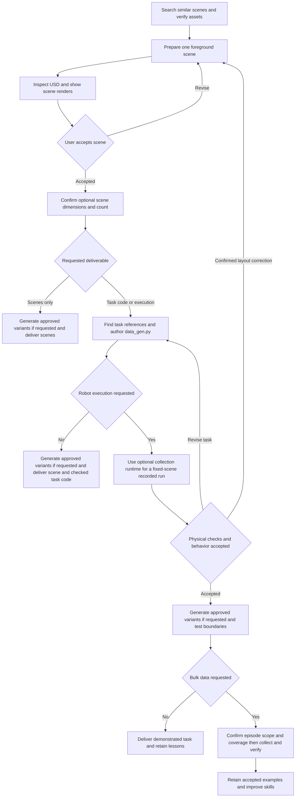

# geniesim_scene_agent — GenieSim scene agent tools

Release version: the local `VERSION` links to the repository root `VERSION`
(**3.5.0**). Wheel metadata and runtime `__version__` use that release value.

Python tools and English agent skills for GenieSim asset search, scene generation, task example retrieval, and automatic collection task orchestration.

## Repository layout

| Path | Contents |
| --- | --- |
| `skills/` | Agent instructions, command references, and small authoring recipes |
| `scene_agent_assets/` | Python asset indexing, embedding search, rendering, and mesh inspection tools |
| `scene_agent_scene/` | Python scene generation, DSL runtime, validation, and similar-scene search tools |
| `src/geniesim_scene_agent/` | Lightweight package identity, CLI, and bundled resource discovery |
| `examples/tasks/` | Task code, scene instances, and file inventories |
| `examples/README.md` | Example usage, task index, and external asset binding instructions |
| `docs/` | Documentation links |
| `.cache/` | Local catalogs, embeddings, and renders; excluded from Git |
| `.models/` | Optional local model weights; excluded from Git |

All examples use `examples/assets`, a symlink to the configured external asset
library. Run `python examples/bind_assets.py` to bind the automatically discovered tree.
See [asset binding instructions](examples/README.md#external-assets).

## External asset discovery

Python tools resolve assets without relying on `examples/assets`, in this order:

1. An explicit `--assets-root` / Python `assets_root` argument.
2. `GENIESIM_ASSETS`.
3. The optional CLI's `geniesim_cli._env.assets_path()` (`GENIESIM_ASSETS_PATH`,
   then legacy `SIM_ASSETS`). These variables also work without the CLI installed.
4. The installed `geniesim_assets` package location, without importing asset code.
5. `assets/` relative to the module or working-directory ancestors, including
   `<workspace>/assets` beside `<workspace>/main/`, and legacy
   `source/geniesim/assets` layouts.

Every selected root must contain `objects/`. An invalid explicit/configured path
raises an error; it does not silently switch libraries. Inspect the result with
`python -m geniesim_scene_agent assets-root`. Catalog creation and DSL builds can
omit `--assets-root`. Existing example USD files retain their portable relative
references; `python examples/bind_assets.py` automatically locates the external
library and creates the local link they require.

## Install

### Monorepo quick start

Use an active Python 3.11 tools environment and run from the GenieSim
monorepo root. **Scene generation is the default standalone installation:**

```bash
python -m pip install -e 'source/geniesim_scene_agent[scene]'
geniesim-scene-agent resources
geniesim-scene-agent assets-root
```

This installs asset search, DSL/direct/hybrid generation, USD inspection,
validation, and the bundled skills/examples. Configure an existing Isaac Sim
renderer with `ISAACSIM_PYTHON`, or use the independent
[scene-agent image](docker/README.md). Scene design and rendering require
neither the data-collection module nor its image. Authoring `data_gen.py`
with the bundled references also works without that execution runtime.

Assets remain external. The `assets-root` command uses the
[discovery order](#external-asset-discovery); set `GENIESIM_ASSETS` or pass an
explicit `--assets-root /path/to/assets` if automatic discovery is unavailable.
See [scene generation](#scene-generation) for recipe, preview, and validation
commands.

For optional GPU embeddings, install the additional dependencies:

```bash
python -m pip install -e 'source/geniesim_scene_agent[scene,vl]'
```

Model weights and the embedding database are prepared separately; full-library
indexing can take a long time. GPU retrieval is independent of data collection.

All seven skills, API references and task examples are included with the
module. Pip installation does not register skills in Codex's global skill
directory or install an LLM agent application. In this project, an agent uses
`AGENTS.md` and [the skill index](skills/README.md); `resources` locates the
bundled library after wheel installation. Global skill registration, when
wanted, is a separate agent configuration step.

After installing this peer, an initialized umbrella can enable it with
`python -m pip install -e 'source/geniesim[scene_agent]'`. It remains an optional
peer; the default `geniesim bootstrap` flow installs tier-1 packages only.
The direct scene-agent installation above is sufficient for scene authoring.
Pip installs Python dependencies and resources only; it does not run Docker,
pull/build an image, start a container, or download embedding model weights.
`geniesim deploy geniesim_scene_agent` builds a wheel only. Build or obtain the
scene-agent image separately when choosing container-based rendering.

From the module root, `python3 docker/build_image.py` builds that independent
image. Add `--china`/`--mirrors NAME` for shared repository presets, or pass your
own `APT_MIRROR` and `PIP_INDEX_URL` with `--build-arg`; explicit values override
presets and persist in the image. See [the container build guide](docker/README.md#build)
for the optional `vl` target, direct Docker commands, and parent-image inheritance.

### Optional task execution and data collection

Add this runtime when robot execution, physical validation, action videos,
or episode collection are requested. Preparing scene files or task code alone
does not require this step. A single physical demonstration also needs the
runtime even when no bulk dataset is requested.

From the monorepo root, install the host CLI and configure collection paths:

```bash
python -m pip install -e source/geniesim_cli
geniesim data-collection install \
  --task-root source/geniesim_scene_agent/examples/tasks \
  --assets-root "$(geniesim-scene-agent assets-root)"
geniesim data-collection config
geniesim data-collection llm list
```

Use a separate writable task library when preparing new tasks, and pass it
with `--task-root` to the collection commands. `data-collection install`
registers the lightweight host locator and saves paths. Isaac Sim, cuRobo,
ROS recording and other execution dependencies are supplied by the compatible
collection image. Reuse an available image; build it only when needed:

```bash
geniesim data-collection build
```

The scene-agent install and image build do not install, pull, or build the
collection image. Task execution commands are documented
[below](#execute-tasks-and-show-recorded-actions).

### Standalone tools and optional dependencies

The following commands run from this module's root, rather than the monorepo
root. Standalone authoring tools do not require the collection runtime.

The base install needs only NumPy and Pillow. It supports directory indexing and existing-image browsing:

```bash
python -m pip install -e .
```

For DSL generation, USD validation, mesh inspection, and support-surface analysis, install USD support in the tools environment:

```bash
python -m pip install -e '.[scene]'
```

The `usd` extra provides the same USD dependency. If the chosen environment already supplies compatible `pxr` modules, the base install can reuse them.

Rendering runs in a separate, configured Isaac Sim environment. Set `ISAACSIM_PYTHON` to that environment's Python executable or `python.sh`; the tools environment and rendering environment may be separate. The renderer uses Isaac Sim's bundled Replicator extensions and needs NumPy and Pillow in that environment. Isaac Sim and GPU drivers are not installed by this package.

**Optional GPU retrieval:** install the VL extra only if you want Qwen3-VL video embeddings:

```bash
python -m pip install -e '.[vl]'
```

The VL extra adds PyTorch, matching torchvision, Transformers, and qwen-vl-utils. Video decoding dependencies such as PyAV come through qwen-vl-utils. Accelerate is not required by the current model loader, which moves the model directly to one GPU. FlashAttention is optional; the backend uses SDPA when it is absent. Install the PyTorch/torchvision builds appropriate for the GPU environment.

This can download or build large dependencies. Model weights are separate; place Qwen3-VL-Embedding-2B weights in `.models/Qwen3-VL-Embedding-2B`, or set `QWEN3_VL_MODEL` or `--model-path`. First-time full-library embedding takes a long time and requires an NVIDIA GPU. Start with `vl-build --folder <category>` to index a smaller directory. If VL is not installed, use `catalog-search`, `render`, and `inspect-usd`.

No Open WebUI, MCP gateway, FastMCP, ChromaDB, OpenAI/Dashscope client, Mitsuba, NetworkX, PyGraphviz, SciPy, jaxtyping, or transforms3d is required by these tools. Catalogs use JSON/Markdown, and the vector index uses Python's built-in SQLite and NumPy. External assets are read from `GENIESIM_ASSETS` without importing an asset package. Running generated robot tasks requires the separate compatible collection runtime; authoring and browsing task examples does not install that runtime.

Wheels include the skills, reference documents, and task example library.
Run `python -m geniesim_scene_agent resources` to locate them after installation.
Change into that directory when using the relative recipe/example commands below.
`geniesim-scene-agent` and `python -m geniesim_scene_agent` expose the scene CLI;
`scene-assets` and `scene-scenes` remain available. `resources` works without USD.

## Use

```bash
export GENIESIM_ASSETS=/path/to/geniesim/assets
python -m scene_agent_assets catalog-build --assets-root "$GENIESIM_ASSETS" --catalog .cache/catalog
python -m scene_agent_assets catalog-search 'yellow block' --catalog .cache/catalog
python -m scene_agent_assets vl-build --catalog .cache/catalog --db .cache/vl.sqlite --folder benchmark/beer
python -m scene_agent_assets vl-search 'beer can' --catalog .cache/catalog --db .cache/vl.sqlite --folder benchmark/beer
python -m scene_agent_assets render --catalog .cache/catalog --folder robolab/yellow_block --output-dir .cache/renders --isaac-python "$ISAACSIM_PYTHON"
python -m scene_agent_assets inspect-usd "$GENIESIM_ASSETS/objects/robolab/yellow_block/robolab_yellow_block_000/Aligned.usda"
```

`catalog-build --scope <folder>` and `vl-build --folder <folder>` limit preparation to a directory beneath `assets/objects`. Build the full catalog when you want to browse other folders later. The VL search response reports how many matching catalog assets have current vectors and how many lack videos. Use [the skill](skills/geniesim-asset-search/SKILL.md) to verify candidates and route to folder browsing when needed.

VL search returns up to 20 candidates by default; use `--top-k` to adjust the pool. Compare multiple candidates before selecting an asset.

## Scene generation

Scene generation is a complete deliverable on its own: no `data_gen.py`,
`task_info.json`, robot runtime, or collection image is required. For task
requests, prepare the scene first, reusing an existing accepted scene when
suitable. During orchestration, scene changes return to the same generation,
metadata, validation, and preview workflow.

Use [the scene-generation skill](skills/geniesim-scene-generation/SKILL.md) to review one rendered foreground scene with the user before any batch. Before planning, search a library of existing task scenes with the bundled [similar-scene tool](skills/geniesim-scene-generation/references/similar-scenes.md). The search is read-only and needs no USD or Isaac Sim installation; pass a task-root directory or set `GENIESIM_SCENE_LIBRARY`.

```bash
python3 -m scene_agent_scene.similar "fruit on each shelf level" \
  --task-root examples/tasks --limit 5
```

The bundled [task examples](examples/README.md) contain 110 orchestration examples and 1,116 scenes: 109 tasks have 10 scene instances each, and the writing task has 26 scene-defined A-Z variants. Use `--task-root examples/tasks` or set `GENIESIM_SCENE_LIBRARY="$PWD/examples/tasks"` to search this library. Assets stay external; run `examples/bind_assets.py` before opening the USD files.

Before authoring `data_gen.py`, use [find-example](skills/find-example/SKILL.md).
Its [Markdown task tables](skills/find-example/references/index.md) cover all
110 tasks in 12 families, with descriptions, scene/action tags, actual API
calls, configuration classes, and scene keywords. Search them from Python:

```bash
python3 -m scene_agent_scene.find_example search "fruit shelf move middle layer" --limit 5
python3 -m scene_agent_scene.find_example search "write letter pen target_letter" --api follow_trajectory
```

The search returns several implementations with code and scene paths. Read
them before adapting their motion phases and object contract. The tables can
be refreshed with `python3 -m scene_agent_scene.find_example rebuild`.

DSL, patched DSL, and direct Python recipes share one output contract. The DSL runtime and renderer are bundled here; only the assets tree is external to scene generation. Isaac Sim's `python.sh` renders all batch instances in one process. For robot-task scenes, use the [RobotAPI quick reference](skills/geniesim-scene-generation/references/robot_api.md) to check the downstream object and keyword contract.

```bash
export ISAACSIM_PYTHON=/path/to/isaac-sim/python.sh
python3 -m scene_agent_scene build --mode dsl \
  --recipe skills/geniesim-scene-generation/examples/table_block_dsl.py \
  --scene-id example_scene --output-root .cache/scenes --assets-root "$GENIESIM_ASSETS" \
  --isaac-python "$ISAACSIM_PYTHON"
python3 -m scene_agent_scene validate .cache/scenes/example_scene/0 --require-renders
python3 -m scene_agent_scene supports .cache/scenes/example_scene/0/scene.usda \
  --markers .cache/support_markers.usda
```

Omitting `--prim` inspects support surfaces under the scene's default root prim.

The tool writes `scene.usda`, `scene_info.json`, `generation.json`, `validation.json`, and three views under `renders/` for each numeric instance. [DSL authoring](skills/geniesim-scene-generation/references/dsl.md) and [commands and recipe hooks](skills/geniesim-scene-generation/references/commands.md) document scene code, joint patches, and approved generalization specs.

## Automatic collection task orchestration

Begin with scene preparation: generate and review a scene, or inspect and reuse
an existing accepted scene. Then use
[task orchestration](skills/geniesim-task-orchestration/SKILL.md) after finding
several reference tasks. Code authoring can end at static validation without
installing a collection image; report physical execution as unverified in that
case. When motion requires an approved layout correction, update the recipe or
patch, USD and metadata together, show the revised scene, and retest affected
phases when execution is requested. The orchestration skill documents scene
contracts, grasp decisions, motion phases, and physical completion checks. The
[complete RobotAPI reference](skills/geniesim-task-orchestration/references/robot_api_reference.md)
contains all public methods, full parameter tables, nine action configs, and
five dual specifications. Use [task validation](skills/geniesim-task-validation/SKILL.md)
for fixed-scene execution, variant coverage, and recording checks.

Each example task has a generated README with interface tags and scene links.
The existing manifest stores `interface_tags`, `configuration_tags`, and
`scene_action_tags`. Refresh these after code changes:

```bash
python3 -m scene_agent_scene.find_example tag --task-root examples/tasks
python skills/geniesim-task-orchestration/scripts/inspect_grasps.py \
  --assets-root "$GENIESIM_ASSETS" --asset-id benchmark_building_blocks_007 --load-poses
```

The grasp inspector runs locally without the collection runtime. Actual robot
execution additionally requires an installed compatible collection runtime
and an Isaac Sim RPC server; set `SIM_ASSETS` to an importable asset package.
No external source checkout or prompt/example service is required to read
the skills or use their authoring references.

## Execute tasks and show recorded actions

Use [data collection](skills/geniesim-data-collection/SKILL.md) with the
configured host CLI and collection runtime. The runtime manages Isaac Sim,
cuRobo, RobotAPI, the server/client, and conversion; its dependencies are not
added to this authoring package. Set the variables to actual prepared paths:

```bash
geniesim data-collection llm show "$TASK_NAME" --task-root "$TASK_ROOT"
geniesim data-collection run "$TASK_NAME" \
  --task-root "$TASK_ROOT" --assets-root "$ASSETS_ROOT" \
  --scene "$SCENE_ID" --run-times 1 --render --output-dir "$RUN_DIR"
```

Recording and headless execution are enabled by default. `--render` directly
records the task's configured cameras and converts videos; replay is optional.
Add `--no-headless` for a live GUI with rendering when host DISPLAY/X11 access
is available. Verify task completion, episode artifacts and MP4 streams before
presenting an action video. See [CLI flags and output contracts](skills/geniesim-data-collection/references/cli.md).

## Complete scene-to-data workflow

Start with [the workflow skill](skills/geniesim-scene-to-data/SKILL.md) when a
request crosses stages. Route by the requested deliverable:

| Requested result | Workflow | Runtime |
| --- | --- | --- |
| Scenes only | Asset search, scene design, rendered review, optional approved variants | Scene tools and Isaac Sim renderer |
| Scene and task code | Scene preparation, example retrieval, `data_gen.py`, static contract checks | Scene tools; robot execution remains unverified |
| Executed task or collected data | Scene preparation, orchestration, physical demonstration, optional approved collection | Add the compatible collection runtime/image |



Reuse accepted scenes and decisions. For requests including robot execution,
defer the expensive scene batch until the base task is validated. Scene-only
batches use scene validation and rendered review. Code-only variants retain
an explicit unverified physical-execution status. 1000 is a common proposed
**scene instance** count; episode counts are a separate decision. Explicit
scene IDs provide coverage, whereas `random` samples with replacement.
Read [phase artifacts and handoffs](skills/geniesim-scene-to-data/references/phase-checklist.md)
for task layout, prepared commands and collection reporting.

## Validate generated artifacts

Use the runtime validation tools on actual scenes and the retained example
library. Scene preview validation does not establish physical robot success.

```bash
python -m scene_agent_scene validate /path/to/scenes/my_scene/0 --require-renders
python examples/bind_assets.py
python examples/validate.py
```

Repository test suites and development test artifacts
are not distributed with this module.

## License

Original AgiBot code is provided under the [Mozilla Public License 2.0](LICENSE).
The vendored Qwen3-VL-Embedding implementation retains Apache License 2.0;
see [third-party notices](THIRD_PARTY_NOTICES.md) and the included license copy.
